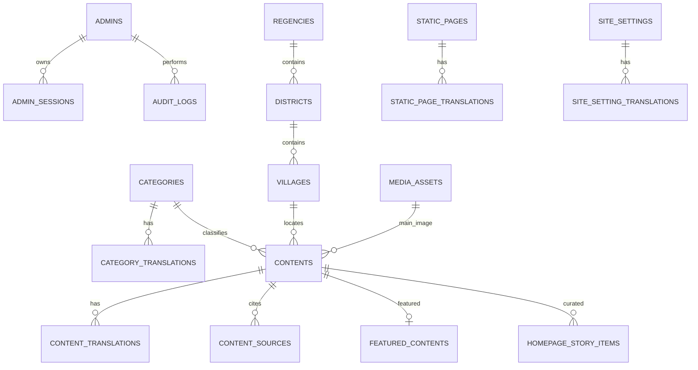

# Database Design And Migration Rules

> Dokumen konsolidasi berdasarkan topik. Materi sumber dipertahankan agar persyaratan dan keputusan tidak hilang.

## Sumber yang digabung

- `database-schema-and-relationships.md`
- `sql-migration-and-data-integrity.md`

---

## Materi sumber: `database-schema-and-relationships.md`

# TECH-003 — Skema Database Awal dan Relasi

**Status: Rancangan awal terintegrasi; perlu divalidasi pada Technical Specification sebelum migration produksi.**

## 1. ERD konseptual

## 2. Tabel identitas dan akses

### `admins`
- `id BIGINT PK`
- `email CITEXT UNIQUE` (atau normalized `email` dengan unique index)
- `password_hash TEXT`
- `display_name TEXT`
- `is_active BOOLEAN NOT NULL DEFAULT TRUE`
- `last_login_at TIMESTAMPTZ NULL`
- `created_at`, `updated_at TIMESTAMPTZ`

Single role untuk seluruh Admin pada MVP; tidak perlu tabel roles/permissions.

### `admin_sessions`
- `id BIGINT PK`
- `admin_id BIGINT FK -> admins.id`
- `token_hash TEXT UNIQUE`
- `expires_at TIMESTAMPTZ`
- `revoked_at TIMESTAMPTZ NULL`
- `created_at TIMESTAMPTZ`
- Index `(admin_id, expires_at)`

Simpan hash token sesi, bukan token mentah. Detail cookie, CSRF, dan session lifecycle ditetapkan pada security specification.

## 3. Kategori dan konten

### `categories`
- `id BIGINT PK`
- `is_active BOOLEAN NOT NULL DEFAULT TRUE`
- `created_at`, `updated_at TIMESTAMPTZ`
- `created_by BIGINT FK -> admins.id`
- `updated_by BIGINT FK -> admins.id`

### `category_translations`
- `id BIGINT PK`
- `category_id BIGINT FK -> categories.id`
- `locale VARCHAR(2) CHECK (locale IN ('id','en'))`
- `name TEXT NOT NULL`
- `description TEXT NULL`
- `slug TEXT NOT NULL`
- `created_at`, `updated_at TIMESTAMPTZ`
- `UNIQUE(category_id, locale)`
- `UNIQUE(locale, slug)`

### `contents`
- `id BIGINT PK`
- `category_id BIGINT FK -> categories.id ON DELETE RESTRICT`
- `village_id BIGINT NULL FK -> villages.id ON DELETE RESTRICT`
- `address TEXT NULL`
- `latitude NUMERIC(9,6) NULL`
- `longitude NUMERIC(9,6) NULL`
- `location_accuracy VARCHAR(16) NULL CHECK (location_accuracy IN ('accurate','approximate'))`
- `main_media_id BIGINT NULL FK -> media_assets.id ON DELETE RESTRICT`
- `created_at`, `updated_at TIMESTAMPTZ`
- `created_by`, `updated_by BIGINT FK -> admins.id`

Check constraint koordinat: latitude antara -90 dan 90, longitude antara -180 dan 180; latitude dan longitude harus keduanya NULL atau keduanya terisi.

### `content_translations`
- `id BIGINT PK`
- `content_id BIGINT FK -> contents.id ON DELETE CASCADE`
- `locale VARCHAR(2) CHECK (locale IN ('id','en'))`
- `title TEXT NOT NULL`
- `slug TEXT NOT NULL`
- `summary TEXT NULL`
- `body JSONB NOT NULL`
- `extra_data JSONB NULL` untuk field kategori opsional yang memang perlu ditampilkan dan dapat berbeda bahasa
- `seo_title TEXT NULL`
- `seo_description TEXT NULL`
- `status VARCHAR(16) CHECK (status IN ('draft','published','archived'))`
- `published_at TIMESTAMPTZ NULL`
- `search_vector TSVECTOR NULL`
- `created_at`, `updated_at TIMESTAMPTZ`
- `created_by`, `updated_by`, `published_by BIGINT NULL FK -> admins.id`
- `UNIQUE(content_id, locale)`
- `UNIQUE(locale, slug)`

Catatan:
- Constraint `UNIQUE(locale, slug)` sengaja sederhana dan aman walaupun URL detail memuat slug kategori.
- `body` menyimpan struktur Rich Text yang tervalidasi dan disanitasi; jangan menyimpan HTML/JS bebas.
- `extra_data` bukan pengganti kolom inti dan tidak digunakan untuk data yang perlu relasi, constraint, atau filtering utama.
- Saat status menjadi Published, `published_at` diisi; saat di-unpublish/archive, nilai dan histori publikasi ditangani konsisten oleh application service.

### `content_sources`
- `id BIGINT PK`
- `content_id BIGINT FK -> contents.id ON DELETE CASCADE`
- `source_type VARCHAR(16) CHECK (source_type IN ('research','visit','official','social'))`
- `source_name TEXT NOT NULL`
- `source_url TEXT NULL`
- `published_at TIMESTAMPTZ NULL`
- `accessed_at TIMESTAMPTZ NULL`
- `notes TEXT NULL`
- `created_at TIMESTAMPTZ`
- `created_by BIGINT FK -> admins.id`

Sumber melekat pada identitas konten, bukan terjemahan, kecuali kelak ada alasan sumber khusus bahasa. Setiap konten wajib memiliki minimal satu sumber yang dapat ditelusuri sesuai DET-002. Ini hanya persyaratan pencatatan referensi, bukan proses verifikasi, approval, atau status Verified. Validasi minimal satu sumber dilakukan oleh application service saat Publish.

## 4. Lokasi master

### `regencies`
- `id BIGINT PK`
- `name TEXT NOT NULL`
- `code TEXT NULL UNIQUE`

### `districts`
- `id BIGINT PK`
- `regency_id BIGINT FK -> regencies.id ON DELETE RESTRICT`
- `name TEXT NOT NULL`
- `code TEXT NULL`
- `UNIQUE(regency_id, name)`

### `villages`
- `id BIGINT PK`
- `district_id BIGINT FK -> districts.id ON DELETE RESTRICT`
- `name TEXT NOT NULL`
- `code TEXT NULL`
- `UNIQUE(district_id, name)`

Master wilayah berisi Kabupaten Pidie, kecamatan, dan gampong yang relevan. Sumber/import/update data master masih perlu ditetapkan. Konten budaya/sejarah boleh tidak memiliki `village_id`.

## 5. Media

### `media_assets`
- `id BIGINT PK`
- `storage_key TEXT UNIQUE NOT NULL`
- `original_filename TEXT NULL`
- `mime_type TEXT NOT NULL`
- `file_size BIGINT NOT NULL CHECK (file_size > 0)`
- `width INTEGER NULL`
- `height INTEGER NULL`
- `alt_text_id TEXT NULL`
- `alt_text_en TEXT NULL`
- `source_url TEXT NULL`
- `rights_status VARCHAR(20) NULL`
- `attribution TEXT NULL`
- `created_at TIMESTAMPTZ`
- `uploaded_by BIGINT FK -> admins.id`

Satu media library dipakai bersama. Media utama konten direferensikan melalui `contents.main_media_id`. Media yang masih direferensikan tidak boleh dihapus. Penyimpanan binary di filesystem/object storage; database hanya menyimpan metadata.

## 6. Kurasi homepage

### `featured_contents`
- `id BIGINT PK`
- `content_id BIGINT UNIQUE FK -> contents.id ON DELETE CASCADE`
- `position INTEGER NOT NULL`
- `created_at TIMESTAMPTZ`
- `created_by BIGINT FK -> admins.id`
- Unique `(position)`

Hanya konten Published pada locale aktif dan kategori Aktif yang ditampilkan. Konten yang tidak memenuhi syarat tidak ditampilkan meskipun masih tercatat dalam kurasi.

### `homepage_story_items`
- `id BIGINT PK`
- `locale VARCHAR(2) CHECK (locale IN ('id','en'))`
- `content_id BIGINT FK -> contents.id ON DELETE CASCADE`
- `role VARCHAR(12) CHECK (role IN ('lead','supporting'))`
- `position INTEGER NOT NULL`
- `created_at`, `updated_at TIMESTAMPTZ`
- `created_by`, `updated_by BIGINT FK -> admins.id`
- `UNIQUE(locale, content_id)`
- Partial unique index: satu `lead` per locale.
- Unique `(locale, role, position)`.

Lead dan supporting tidak boleh duplikat dalam locale yang sama. Konten hanya tampil jika terjemahan locale terkait Published dan kategori Aktif.

## 7. Halaman statis dan pengaturan

### `static_pages`
- `id BIGINT PK`
- `page_key TEXT UNIQUE NOT NULL` (misalnya `about`, `contact`, `privacy-policy`, `disclaimer`)
- `created_at`, `updated_at TIMESTAMPTZ`

### `static_page_translations`
- `id BIGINT PK`
- `static_page_id BIGINT FK -> static_pages.id ON DELETE CASCADE`
- `locale VARCHAR(2) CHECK (locale IN ('id','en'))`
- `title TEXT NOT NULL`
- `slug TEXT NOT NULL`
- `body JSONB NOT NULL`
- `seo_title`, `seo_description TEXT NULL`
- `status VARCHAR(16) CHECK (status IN ('draft','published','archived'))`
- `published_at TIMESTAMPTZ NULL`
- `UNIQUE(static_page_id, locale)`
- `UNIQUE(locale, slug)`

### `site_settings`
- Satu record konfigurasi utama (singleton).
- `id SMALLINT PRIMARY KEY CHECK (id = 1)`
- `logo_media_id BIGINT NULL FK -> media_assets.id ON DELETE RESTRICT`
- `favicon_media_id BIGINT NULL FK -> media_assets.id ON DELETE RESTRICT`
- `contact_email TEXT NULL`
- `contact_phone TEXT NULL`
- `contact_address TEXT NULL`
- `social_links JSONB NULL`
- `updated_at TIMESTAMPTZ`
- `updated_by BIGINT FK -> admins.id`

### `site_setting_translations`
- `id BIGINT PK`
- `site_settings_id SMALLINT FK -> site_settings.id`
- `locale VARCHAR(2) CHECK (locale IN ('id','en'))`
- `site_name TEXT NOT NULL`
- `tagline TEXT NULL`
- `description TEXT NULL`
- `default_seo_title TEXT NULL`
- `default_seo_description TEXT NULL`
- `UNIQUE(site_settings_id, locale)`

## 8. Publication, redirect, audit

### `site_generation_jobs`
- `id BIGINT PK`
- `job_type VARCHAR(24) NOT NULL`
- `payload JSONB NOT NULL DEFAULT '{}'`
- `status VARCHAR(16) CHECK (status IN ('pending','processing','succeeded','failed'))`
- `attempts INTEGER NOT NULL DEFAULT 0`
- `available_at TIMESTAMPTZ NOT NULL`
- `locked_at TIMESTAMPTZ NULL`
- `last_error TEXT NULL`
- `created_at`, `updated_at TIMESTAMPTZ`
- Index `(status, available_at, created_at)`

Job dibuat dalam transaksi yang sama dengan perubahan publikasi. Worker mengambil job menggunakan locking yang aman (misalnya `FOR UPDATE SKIP LOCKED`). Retry dibatasi dan kegagalan tercatat. Tidak memerlukan Redis/message broker.

### `url_redirects`
- `id BIGINT PK`
- `old_path TEXT UNIQUE NOT NULL`
- `new_path TEXT NOT NULL`
- `status_code SMALLINT NOT NULL DEFAULT 301 CHECK (status_code = 301)`
- `created_at TIMESTAMPTZ`
- `created_by BIGINT NULL FK -> admins.id`
- Validasi aplikasi mencegah old_path = new_path, loop, dan chain.

### `audit_logs`
- `id BIGINT PK`
- `admin_id BIGINT NULL FK -> admins.id ON DELETE SET NULL`
- `action TEXT NOT NULL`
- `entity_type TEXT NOT NULL`
- `entity_id BIGINT NULL`
- `metadata JSONB NULL` (hanya metadata aksi, tidak menyimpan salinan penuh konten yang dihapus)
- `ip_address INET NULL`
- `created_at TIMESTAMPTZ`
- Index `(created_at DESC)`, `(entity_type, entity_id)`, `(admin_id, created_at DESC)`.

## 9. Index minimum

- `category_translations(locale, slug)` UNIQUE.
- `content_translations(locale, slug)` UNIQUE.
- `content_translations(content_id, locale)` UNIQUE.
- `content_translations(locale, status, published_at DESC)`.
- `contents(category_id)`.
- `contents(village_id)`.
- `content_sources(content_id)`.
- `featured_contents(position)`.
- `homepage_story_items(locale, role, position)`.
- GIN `content_translations(search_vector)`.
- `site_generation_jobs(status, available_at, created_at)`.
- `url_redirects(old_path)` UNIQUE.

Foreign key yang sering dipakai untuk join harus memiliki index yang sesuai. Index final diverifikasi melalui query nyata dan EXPLAIN ANALYZE.

## 10. Keputusan yang masih perlu divalidasi
- Driver `pgx/v5` dan strategi query tetap mengikuti TECH-002.
- Pilihan extension `citext` atau normalized email untuk admins.
- Format Rich Text JSON dan media references.
- Search vector konfigurasi ID/EN.
- Session lifecycle dan CSRF.
- Retensi audit log dan generation jobs.
- Storage file media.
- Strategi full vs incremental SSG generation.
- Detail import/update master wilayah.

---

## Materi sumber: `sql-migration-and-data-integrity.md`

# TECH-004 — SQL Migration dan Aturan Konsistensi

**Status: Baseline SQL awal dibuat; validasi teknis diperlukan sebelum produksi.**

## Migration
- Migration file berada pada `01-technical/database/migrations/`.
- Gunakan migration versioned dan urut.
- Perubahan schema berikutnya dibuat sebagai migration baru; jangan mengedit migration yang sudah diterapkan pada environment bersama/produksi.
- Backup sebelum migration yang mengubah atau menghapus data.
- Jalankan migration sebagai langkah deployment terkontrol.

## Konsistensi lintas modul
- `contents.category_id` wajib merujuk kategori yang ada.
- Kategori yang masih direferensikan konten tidak dapat dihapus (`ON DELETE RESTRICT`).
- Kategori nonaktif tidak dapat dipakai saat membuat/memindahkan konten dan tidak boleh muncul pada query publik; validasi dilakukan di application layer.
- Satu konten memiliki maksimum satu translation per locale.
- Satu locale/slug konten unik; demikian pula locale/slug kategori dan static page.
- Publish per locale hanya dapat dilakukan jika konten memiliki title, body, kategori aktif, dan minimal satu sumber yang dapat ditelusuri.
- Tidak ada status Verified atau approval.
- Konten yang dihapus permanen menghapus translations dan sources terkait melalui cascade, serta menghapus relasi curation. Media bersama tidak ikut terhapus.
- Media yang masih dipakai sebagai media utama atau logo tidak dapat dihapus.
- Static content, SEO, dan redirect harus diperbarui melalui publication pipeline setelah perubahan yang memengaruhi website publik.

## Transaksi publikasi dan job generation
Satu transaksi database harus:
1. Memvalidasi status kategori aktif.
2. Memvalidasi minimal satu sumber konten.
3. Memperbarui status translation dan published metadata.
4. Menulis audit event.
5. Menambahkan `site_generation_jobs`.

Jika transaksi gagal, tidak ada perubahan publikasi maupun job yang tertinggal.

Worker:
- Claim job dalam transaksi pendek menggunakan `FOR UPDATE SKIP LOCKED`.
- Commit claim sebelum menjalankan proses generate.
- Jalankan build di direktori release sementara.
- Aktifkan release hanya setelah build berhasil dan validasi output lolos.
- Catat sukses/gagal dan retry terbatas.
- Jangan pernah menghapus release aktif terakhir saat build baru gagal.

## Query publik
Semua query publik harus menerapkan:
- Locale yang diminta.
- Translation berstatus `published`.
- Kategori berstatus `is_active = true`.
- Aturan curated content dan pagination yang sudah disepakati.
- Jangan mengembalikan Draft/Archived melalui endpoint publik.

## Catatan validasi
DDL baseline tidak dapat menjamin seluruh aturan lintas tabel hanya dengan CHECK constraints. Validasi seperti minimal satu source, kategori aktif saat publish, redirect graph tanpa loop, dan status terjemahan di query publik harus dijaga oleh application service/transaction. Tambahkan integration tests untuk aturan tersebut.

---
